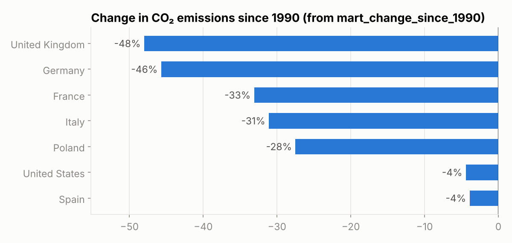

# Energy & emissions data pipeline

An ETL pipeline that collects public energy and CO₂ data every month, checks its quality, reshapes it into a small warehouse and builds analysis-ready tables. It runs on its own with Python, or on a schedule with Apache Airflow in Docker.

I built it to practise the same kind of work I do in my research job (automated, reproducible pipelines with Airflow and Docker), but on open data that I can share.

## What it does

```
Our World in Data (CO₂ + energy CSV)
        │
   1. extract    download the raw files, one folder per run date
        │
   2. validate   schema, duplicates, value ranges, freshness → stops the run if something is wrong
        │
   3. transform  keep countries only, join both sources, compute indicators → Parquet
        │
   4. load       DuckDB warehouse (dim + fact tables), then SQL marts
```

Warehouse tables:

| Table | Content |
|-------|---------|
| `dim_country` | 218 countries with their first and last year of data |
| `fact_country_year` | one row per country and year since 1990: emissions, population, energy mix, carbon intensity, yearly change |
| `mart_country_latest` | latest year for each country, ready for a dashboard |
| `mart_change_since_1990` | change in emissions and low-carbon energy share since 1990 |

## A few design choices

- **Re-runnable.** Raw files are stored per run date and downloads are written to a temporary file first, so a failed run never leaves a half-written file and re-running the same day does not download again.
- **Fail early.** The validation step raises an error before anything is loaded: a truncated file, a missing column or a share above 100% never reaches the warehouse.
- **All-or-nothing load.** Tables and marts are rebuilt in a single transaction. If one SQL model fails, the previous version of the warehouse stays intact.
- **Same code with or without Airflow.** The DAG only calls the functions in `pipeline/`, so the logic can be tested and run locally without an orchestrator.

## Example of use

Once the warehouse is built, any analysis is a SQL query away. [`report.py`](report.py) reads `mart_change_since_1990`:



## Project structure

```
pipeline/   extract.py · validate.py · transform.py · load.py · run.py · config.py
sql/        SQL models for the marts
dags/       Airflow DAG (monthly schedule, 2 retries)
tests/      unit tests (pytest)
```

## Run it

Locally:

```bash
pip install -r requirements.txt
python -m pipeline.run          # builds data/warehouse.duckdb
python -m pytest -q
python report.py
```

With Airflow (Docker):

```bash
docker compose up --build
```

Then open http://localhost:8080, log in with the admin password shown in the container logs, and trigger `energy_emissions_pipeline`.

## What I would add next

Alerts (e-mail or Slack) when validation fails, a PostgreSQL warehouse instead of DuckDB for multi-user access, and dbt to manage the SQL models with their own tests and documentation.
